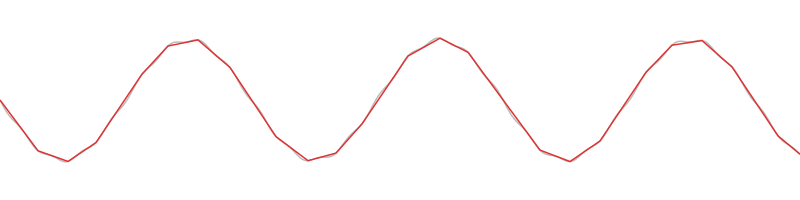

# line-simplifier

A small C++17 header-only library that simplifies a noisy line into far fewer points, using the Ramer–Douglas–Peucker algorithm. It is the same idea map apps use to draw a long coastline without sending every point.


Grey: original 401 points. Red: simplified to 24 points (epsilon = 3).

## Try it (20 seconds)
```
make          # builds the demo and runs the tests
./demo 3      # simplify with tolerance 3, writes out.svg
```
Results on the demo line (401 points):

| epsilon | points kept |
|---------|-------------|
| 1       | 57          |
| 3       | 24          |
| 8       | 17          |

## How it works
1. Draw a straight line from the first point to the last.
2. Find the point furthest from that line.
3. If it is further than `epsilon`, keep it and repeat on both halves. Otherwise drop everything in between.

## Design choices
- **Explicit stack instead of recursion**, so a very long line cannot overflow the call stack.
- **Header-only** (`src/simplify.hpp`), so it drops into any project.
- **Zero-length segments handled**, so no divide by zero when two points coincide.

## Tests
`tests/test.cpp` checks that straight lines collapse to two points, sharp corners survive, tiny inputs are unchanged, and no removed point ends up further than `epsilon` from the result.

Written by Lim Yan De. Original work, not from any course.
